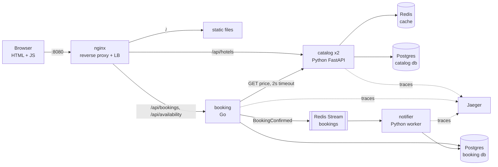
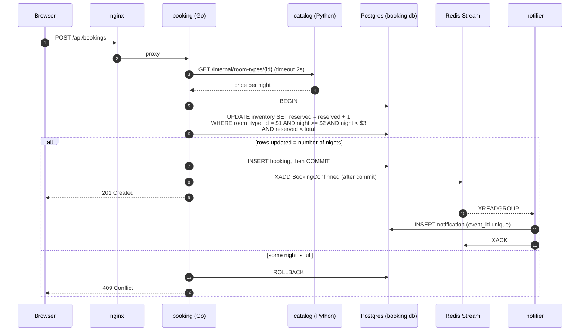

# hotel-booking: a walking skeleton

A small but real hotel-booking product, built end to end: browser → reverse proxy → services → cache → databases → async worker, with tracing across all of it. It starts tiny and grows one component per step, so every component is added because of a problem you can see.

Later labs deepen one part of this system at a time (for example, lab 01 compares concurrency strategies inside its booking service).

## What the product does

1. Search hotels by city.
2. Open a hotel: room types, price per night, availability for your dates.
3. Book a room for a date range.
4. See your bookings; get a confirmation "email" shortly after.

No login yet (auth is lab 06). The guest types an email address, which identifies their bookings.

## Requirements

**Functional**

| API | Owner | Purpose |
|---|---|---|
| `GET /api/hotels?city=` | catalog | Search hotels |
| `GET /api/hotels/{id}` | catalog | Hotel detail with room types and nightly price |
| `GET /api/availability?room_type_id=&check_in=&check_out=` | booking | Rooms left for each night of the stay |
| `POST /api/bookings` | booking | Book a room type for `[check_in, check_out)` |
| `GET /api/bookings/{id}`, `GET /api/bookings?email=` | booking | View bookings |

**Non-functional (targets, measured as we go)**

| Property | Target | Proven in step |
|---|---|---|
| One command to run | `make demo` → http://localhost:8080 | 1 |
| No double booking | 50 concurrent requests for the last room → exactly 1 succeeds | 3 |
| Survives one catalog instance dying | no failed reads during the kill | 2 |
| Booking with catalog down | fails fast (≤ 2 s, HTTP 503), never hangs | 3 |
| Search latency | p99 < 20 ms with cache warm (local) | 4 |
| Redis down | site still works, only slower | 4 |
| Worker down | bookings still succeed; every notification is sent after restart, once | 5 |
| Debuggability | one click = one trace across all services | 6 |

**Out of scope for the skeleton:** auth, payments, cancellation, idempotency keys and the outbox. Each is a later lab, and the skeleton deliberately leaves them as known gaps (see the failure modes).

## Architecture (final, after step 6)



### Request flow: booking a room



### Data ownership (database per service)

| Database | Owner | Tables |
|---|---|---|
| `catalog` | catalog service | `hotels(id, name, city, stars, lat, lon)`, `room_types(id, hotel_id, name, capacity, price_cents)` |
| `booking` | booking service | `inventory(room_type_id, night, total, reserved)` PK `(room_type_id, night)`, `bookings(id, email, hotel_id, room_type_id, check_in, check_out, total_cents, status, created_at)` |
| `booking` | notifier | `notifications(event_id PK, booking_id, sent_at)` |

Both databases live in one Postgres container to save RAM. Each service only gets credentials for its own database, so "no cross-service joins" is enforced, not just a convention.

## The six steps

Each step ends with a git tag (`step-1` … `step-6`), so `git diff step-2 step-3` shows exactly what a new component costs in code.

| Step | Adds | The problem it solves | Break it (experiments) |
|---|---|---|---|
| 1 | Static UI, catalog service, Postgres, seed data | Show real data from a database | Stop Postgres: what does the UI show? Watch DevTools → Network |
| 2 | nginx in front; 2 catalog instances | One entry point, scale out, no CORS | Kill one instance under load: errors or none? Who retried? |
| 3 | Booking service (Go), its own DB, call to catalog | First service split; correct inventory | Stop catalog: does booking hang or fail fast? Fire 50 bookings at the last room |
| 4 | Redis cache-aside on hotel reads | Repeated reads hammer the DB | p99 with vs without cache; stop Redis; change a price and see stale data |
| 5 | Redis Stream + notifier worker | Don't make the user wait for slow side effects | Kill the worker, book, restart it; deliver twice and see dedupe; kill Redis right after commit |
| 6 | OpenTelemetry → Jaeger, metrics → Prometheus | "Where did the 800 ms go?" | Inject 300 ms latency into catalog and find it in the trace |

Each step comes with a short guide in `steps/NN-*.md`:
1. **Why**: the problem, in five lines.
2. **Read**: the files to read, in order, with the key lines called out.
3. **Run**: copy-paste commands with the expected output.
4. **Predict → break → observe**: guess first, then see.
5. **Mental model**: one sentence to keep.
6. **Interview drill**: 3 questions to answer before reading the model answers.

## Decisions and trade-offs

| Decision | Chosen | Alternative | Why |
|---|---|---|---|
| Frontend | One HTML page + plain JS (`fetch`) | React/Next.js | The lesson is the backend; zero build tooling, every request is visible in DevTools |
| Entry point | nginx reverse proxy | Browser calls each service directly | One origin (no CORS), TLS/LB/routing in one place: what an API gateway does, minus the extras |
| Catalog in Python | FastAPI + psycopg + uvicorn | Go | Read-heavy CRUD; shows a polyglot system and lets you compare the two ecosystems |
| Booking in Go | `net/http` + pgx | Python | The correctness- and concurrency-critical path; it becomes lab 01 |
| Who owns inventory | booking service | catalog service | Inventory must change in the same transaction as the booking; splitting them would need a distributed transaction |
| Inventory model | One row per room type per night | One counter per room type | Hotels sell nights: a 3-night stay needs all 3 nights free, updated atomically |
| Double-booking guard | Conditional `UPDATE … WHERE reserved < total` in one transaction | `SELECT … FOR UPDATE`, optimistic versions | Simplest correct option, one round trip; lab 01 measures all of them |
| Price at booking time | Synchronous call to catalog with a 2 s timeout | Copy prices into booking db via events | Simple and always fresh; costs coupling (catalog down means no bookings). We'll feel that in step 3 |
| UI composes two services | Browser calls catalog and booking separately | A BFF/aggregation layer | Keeps services independent; a BFF is discussed in the step 3 drill |
| Async messaging | Redis Streams with a consumer group | Kafka, RabbitMQ | Already running; has consumer groups, acks and pending lists. Kafka arrives in lab 13 |
| Publishing the event | `XADD` after `COMMIT` | Transactional outbox | Deliberately the naive dual write, so you can see the gap. Lab 07 fixes it |
| Schema setup | One-shot migration container per service, which must finish before the service starts | Each instance migrates on boot | Two catalog instances migrating at once would race; this is the Kubernetes init-container/Job pattern |
| Config | Environment variables | Config files baked into images | Same image in every environment (12-factor) |
| Health | `/livez` (process up) and `/readyz` (DB reachable) | One `/health` | The proxy should stop routing to an instance that's alive but can't serve |

## Failure modes

| Failure | Detection | Mitigation | Test or experiment that proves it |
|---|---|---|---|
| A catalog instance crashes | nginx upstream errors | nginx retries **GET only** on the other instance (`proxy_next_upstream`) | Step 2: kill an instance under k6 load; count failed requests |
| Catalog down or slow when booking | 2 s client timeout in booking | Fail fast with 503; never hold a DB transaction across the network call | Step 3: stop catalog; booking returns 503 in ≤ 2 s |
| Two guests race for the last room | — | Conditional `UPDATE` plus checking the row count, in one transaction | Step 3: integration test with 50 concurrent requests → exactly 1 succeeds |
| Client retries `POST /bookings` after a timeout | Duplicate bookings for the same guest | **Known gap**: `Idempotency-Key` in lab 01 | Step 3 drill: reproduce the duplicate by hand |
| Redis down | Cache errors in logs | Short Redis timeout, fall through to Postgres | Step 4: stop Redis; site still works; measure the latency change |
| Stale price shown after an update | — | TTL 60 s plus delete-on-write | Step 4: update a price in SQL; observe staleness up to the TTL |
| Cache stampede on a hot hotel | DB QPS spike | Noted here; single-flight comes in lab 03 | Step 4 drill |
| Notifier down | Stream backlog grows (`XPENDING`, `XLEN`) | Consumer group keeps unacked messages; worker resumes | Step 5: kill worker, book 5 times, restart, 5 notifications |
| Same event delivered twice | — | `notifications.event_id` primary key; insert-if-absent | Step 5: replay a message; still one notification |
| Crash between `COMMIT` and `XADD` | Booking with no notification | **Known gap**: transactional outbox in lab 07 | Step 5: kill Redis right after commit; the notification is lost |
| Postgres down | `/readyz` fails | Services report not-ready; UI shows a clear error | Step 1: stop Postgres, read what each layer returns |

## Layout

```
apps/hotel-booking/
  README.md            this design
  compose.yml          the whole product: make demo
  steps/               one guide per step
  web/                 index.html, app.js
  nginx/nginx.conf
  catalog/             Python (uv): FastAPI app, migrations, seed, tests
  booking/             Go: cmd + internal packages, migrations, tests
  notifier/            Python worker
  load/                k6 scripts
```

Ports on the host: **8080** for the site; **16686** for Jaeger and **9090** for Prometheus from step 6; **15432** for Postgres and **16379** for Redis (for `psql`/`redis-cli` poking). The shared lab infra uses different ports, so both can run at once.

## Measured numbers

Filled in as each step is built: real output only.

| Step | Measurement | Result |
|---|---|---|

## 2-minute story

Written at the end of step 6.
