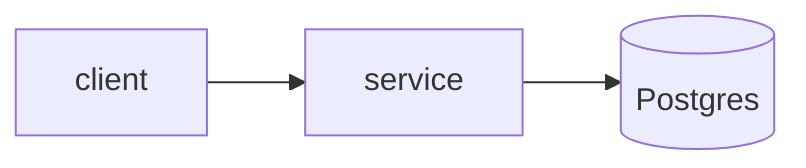

# NN · lab-name

> Template: copy this folder to `labs/NN-name/` and fill every section. Delete this line.

## Exercise

Week N, #M: *one-line concept from the cohort catalogue.*

## Twist

What this lab actually builds on top of the exercise, and why.

## Requirements

- Functional:
- Non-functional (with numeric targets):
- Out of scope:

## Design



## Decisions and trade-offs

| Decision | Chosen | Alternative | Why |
|---|---|---|---|

## Failure modes

| Failure | Detection | Mitigation | Test that proves it |
|---|---|---|---|

## Gotchas (from the exercise), worked through

| Gotcha | What happens here | Where it's handled / tested |
|---|---|---|

## Verify: measured numbers

Machine: WSL2, 8 vCPU, 7 GB RAM. Command to reproduce: `make bench LAB=NN-name`

| Scenario | Result |
|---|---|

## Run it

```bash
make up
make it LAB=NN-name
make bench LAB=NN-name
```

## 2-minute story

Problem → the naive approach and how it breaks → what I built → the one number I measured → what I'd do next at 10× scale.

## Stretch

- [ ] …
